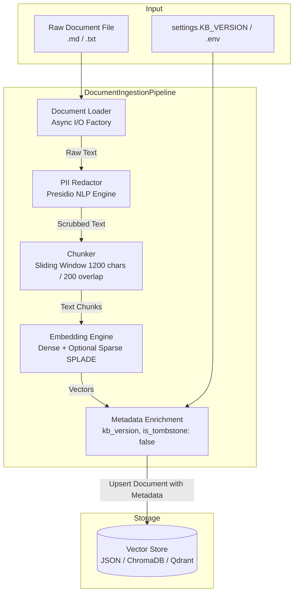

# Document Ingestion Pipeline: Versioning & Tombstones Guide

This document provides a comprehensive operational and architectural guide to the **Document Ingestion Pipeline** in this RAG system, with detailed focus on **Knowledge Base Versioning (`kb_version`)** and **Document Tombstones (`is_tombstone`, soft deletion)**.

---

## 📑 Table of Contents
1. [Overview & Motivation](#1-overview--motivation)
2. [Ingestion Architecture & End-to-End Flow](#2-ingestion-architecture--end-to-end-flow)
3. [Knowledge Base Versioning (`kb_version`)](#3-knowledge-base-versioning-kb_version)
4. [Document Tombstones & Soft-Deletion](#4-document-tombstones--soft-deletion)
5. [Complete Ingestion Metadata Schema](#5-complete-ingestion-metadata-schema)
6. [Vector Store Implementation Details](#6-vector-store-implementation-details)
7. [Usage & Operational Runbook](#7-usage--operational-runbook)
8. [Troubleshooting & Best Practices](#8-troubleshooting--best-practices)

---

## 1. Overview & Motivation

In enterprise RAG applications (such as employee handbooks, policy repositories, and technical knowledge bases), documentation is never static. Policies change, benefits are updated annually, and outdated documents must be retired.

Historically, RAG systems handled document deletion via hard-deleting points from the vector database. In production, this introduces severe challenges:
* **Index Graph Degradation**: Modern Approximate Nearest Neighbor (ANN) indexes (such as HNSW) degrade in search quality and consume excessive re-indexing compute when points are repeatedly hard-deleted.
* **Loss of Audit Trail**: Compliance, legal, and HR governance frameworks require an immutable record of which policies were active at any given historical point.
* **Stale Context Leakage**: Without explicit corpus versioning, re-ingested documents create conflicting chunk duplicates that degrade retrieval relevance and hallucination metrics.

To solve this, our ingestion pipeline introduces:
1. **Knowledge Base Versioning (`kb_version`)**: Stamping every chunk and document with a version tag for traceability and lifecycle management.
2. **Document Tombstones**: A soft-deletion pattern that flags retired or superseded documents with `is_tombstone = True` and timestamp metadata, ensuring they are excluded from search while preserving historical records.

---

## 2. Ingestion Architecture & End-to-End Flow

The orchestration of ingestion is managed by `DocumentIngestionPipeline` in `src/pipeline/store.py`.



### Step-by-Step Processing:
1. **Load**: `DocumentLoadFactory.get_loader()` loads the file asynchronously without blocking the event loop.
2. **PII Redaction (Optional)**: Microsoft Presidio detects and masks personal identifiers (SSNs, phone numbers, email addresses) before chunking.
3. **Chunking**: `SlidingWindowChunking` creates fixed-length chunks (1,200 characters with 200-character overlap) to guarantee context preservation across boundaries.
4. **Vector Embedding**: `ModelSelector` batches chunks and generates dense vectors (via OpenAI or Ollama) and sparse vectors (via FastEmbed SPLADE if hybrid search is enabled).
5. **Metadata Enrichment**: Attaches `kb_version`, `is_tombstone: False`, and timestamp attributes to each chunk.
6. **Persistence**: Upserts vectors and metadata into the active vector database.

---

## 3. Knowledge Base Versioning (`kb_version`)

Every document and chunk ingested into the vector database carries a `kb_version` identifier.

### Configuration
You can set the global knowledge base version in your `.env` file or `config/settings.py`:

```ini
# .env
KB_VERSION=v2.0
DATA_DIRECTORY=/path/to/handbook_files
```

In `config/settings.py`:
```python
class Settings(BaseSettings):
    KB_VERSION: str = "v1.0"
```

### Programmatic Usage
When invoking `DocumentIngestionPipeline`, you can override `kb_version` dynamically:

```python
from pipeline.store import DocumentIngestionPipeline

pipeline = DocumentIngestionPipeline()

# Ingest a single file with a specific version tag
await pipeline.ingest_file("data/handbook/pto_policy_2026.md", kb_version="v2.1")

# Ingest an entire directory with a version release tag
await pipeline.ingest_directory("data/handbook_v3/", kb_version="v3.0")
```

### Versioning Benefits:
* **Release Scoping**: Track when policies were refreshed (e.g., `v1.0-2024`, `v2.0-2025`).
* **Multi-Version Indexing**: Supports holding multiple revisions concurrently in the same collection.
* **Corpus Traceability**: Each retrieved chunk in the inference logs shows its exact `kb_version`.

---

## 4. Document Tombstones & Soft-Deletion

### What is a Tombstone?
A **Tombstone** is a record marker indicating that a document has been deleted or deprecated without physically destroying the underlying data or disrupting the vector index.

```
+-------------------------------------------------------------+
| Active Document (is_tombstone: false)                       |
|   -> Included in nearest neighbor search                    |
|   -> Evaluated during HyDE & Cross-Encoder reranking        |
+-------------------------------------------------------------+
                            │
              tombstone_file("policy.md")
                            ▼
+-------------------------------------------------------------+
| Tombstoned Document (is_tombstone: true)                    |
|   -> tombstoned_at: "2026-10-22T16:40:00+00:00"             |
|   -> tombstone_reason: "Superseded by v2.0 policy"          |
|   -> Filtered out automatically during retriever search     |
|   -> Preserved in DB for audit lineage & instant rollback   |
+-------------------------------------------------------------+
```

### Tombstone Lifecycle
1. **Creation**: When a file is first ingested, `is_tombstone` is set to `False`, and `tombstoned_at` is `null`/empty.
2. **Tombstoning**: An administrator or pipeline triggers `pipeline.tombstone_file(filename, reason)`. The document's metadata is updated in place.
3. **Retrieval Filtering**: During `search()`, the vector store filters out any chunk where `is_tombstone == True`.
4. **Reinstatement / Re-ingestion**: If a document is re-ingested, deduplication logic (`scratch.py`) cleans up the old entry and writes a fresh active record with the updated `kb_version`.

### Tombstone Programmatic API
```python
from pipeline.store import DocumentIngestionPipeline

pipeline = DocumentIngestionPipeline()

# Tombstone a superseded policy document
success = pipeline.tombstone_file(
    filename="old_benefits_2023.md",
    reason="Superseded by 2026 Benefits Guide v2.0"
)

if success:
    print("Document successfully tombstoned. It will no longer appear in search results.")
```

---

## 5. Complete Ingestion Metadata Schema

Every vector point saved in the vector database includes the following metadata fields:

| Field Name | Type | Required | Description | Example |
| :--- | :--- | :--- | :--- | :--- |
| `file_name` | `str` | Yes | Name of the source file | `"parental_leave.md"` |
| `file_type` | `str` | Yes | File extension / format | `"md"`, `"txt"` |
| `kb_version` | `str` | Yes | Version identifier of the knowledge base | `"v1.0"`, `"v2.1"` |
| `is_tombstone` | `bool` | Yes | Whether the chunk is soft-deleted | `false` (active), `true` (tombstone) |
| `tombstoned_at` | `str \| None` | No | ISO-8601 UTC timestamp of tombstoning | `"2026-10-22T16:40:00+00:00"` |
| `tombstone_reason`| `str \| None` | No | Reason why the document was tombstoned | `"policy sunset"`, `"deprecated"` |
| `sparse_embedding`| `dict \| None`| No | Indices and values for SPLADE keyword search | `{"indices": [...], "values": [...]}` |

---

## 6. Vector Store Implementation Details

The tombstone and versioning logic is implemented uniformly across all three supported vector stores in `src/rag/vector_store.py`:

### 1. `JSONVectorStore` (Local File / Fallback)
* **Storage**: Stored in a JSON file (default `data/db/vector_store.json`).
* **Tombstone Operation**: `tombstone_document()` updates both the top-level document entry and all nested chunk metadata dictionaries in place with `is_tombstone: True`, `tombstoned_at`, and `tombstone_reason`.
* **Search Filtering**: In `search()`, checks:
  ```python
  if file_data.get("is_tombstone", False):
      continue
  if chunk_meta.get("is_tombstone", False):
      continue
  ```

### 2. `ChromaDBStore` (Local Persistent DB)
* **Storage**: Stored in SQLite/DuckDB-backed Parquet via ChromaDB in `data/db/`.
* **Tombstone Operation**: Fetches all IDs matching `file_name == filename`, updates their metadata dictionary to include `is_tombstone: True` and timestamp, and calls `collection.update()`.
* **Search Filtering**: Over-queries candidate chunks (`n_results=top_k * 2`) and filters out any item where `metadata.get("is_tombstone") is True` before returning top-k.

### 3. `QdrantStore` (Production Engine)
* **Storage**: Standalone or Dockerized Qdrant instance.
* **Tombstone Operation**: Uses `client.set_payload()` with a `models.Filter` matching `file_name == filename` to update the payload in-place without vector re-computation:
  ```python
  self.client.set_payload(
      collection_name=self.collection_name,
      payload={"is_tombstone": True, "tombstoned_at": now_iso, "tombstone_reason": reason},
      points=models.Filter(must=[models.FieldCondition(key="file_name", match=models.MatchValue(value=filename))])
  )
  ```
* **Search Filtering**: Excludes points with `payload.get("is_tombstone") is True` during retrieval.

---

## 7. Usage & Operational Runbook

### Step 1: Set Ingestion Environment
In `.env`:
```ini
DATA_DIRECTORY=/Users/anya/Documents/OktaSkill/AIRAG/AIARAG-Capstone-Project copy/data/raw_markdown/
KB_VERSION=v1.0
USE_PII_REDACTION=true
USE_HYBRID_SEARCH=true
```

### Step 2: Run Ingestion
Execute the ingestion script:

* **Linux / Mac**:
  ```bash
  bash bin/run_ingestion.sh
  ```
* **Windows**:
  ```powershell
  .\bin\run_ingestion.ps1
  ```

The pipeline will log:
```
INFO - 1. Loading Document.....vacation_policy.md (KB Version: v1.0)
INFO - 2. Document Chunking.....vacation_policy.md
INFO - 3. Embeddings.....vacation_policy.md
INFO - 4. Vector Storage.....vacation_policy.md [KB Version: v1.0, Tombstone: False]
```

### Step 3: Tombstoning an Outdated Document
To retire an outdated document from production retrieval:

```python
from pipeline.store import DocumentIngestionPipeline

pipeline = DocumentIngestionPipeline()
pipeline.tombstone_file("old_travel_expenses.md", reason="Replaced by travel_policy_2026.md")
```

Verify in inference:
```bash
sh bin/run_inference.sh "What is the travel expense policy?"
```
The tombstoned document will not appear in the retrieved context chunks.

---

## 8. Troubleshooting & Best Practices

1. **Re-ingesting a Tombstoned Document**:
   If you re-run ingestion on a file with the same name, `src/rag/scratch.py` automatically clears the old tombstoned entry, and the pipeline re-inserts the new document as active (`is_tombstone: False`) with the current `KB_VERSION`.

2. **Auditing Tombstones**:
   To inspect all tombstoned documents in the JSON store:
   ```bash
   python -c "import json; data=json.load(open('data/db/vector_store.json')); print([k for k, v in data.items() if v.get('is_tombstone')])"
   ```

3. **Verifying in Unit Tests**:
   The test suite validates both `kb_version` and tombstone filtering:
   ```bash
   ./.venv/bin/pytest tests/test_rag.py -k "tombstone or kb_version" -v
   ```
